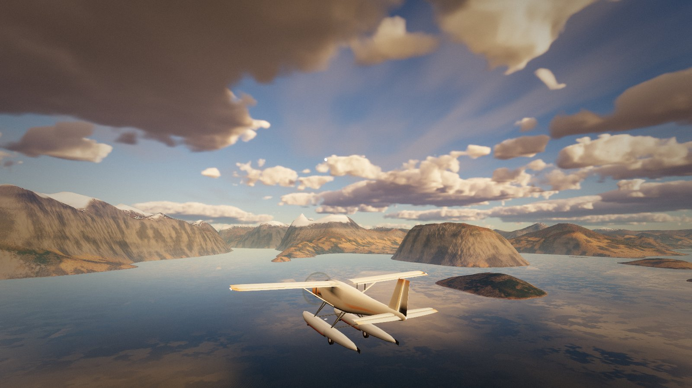
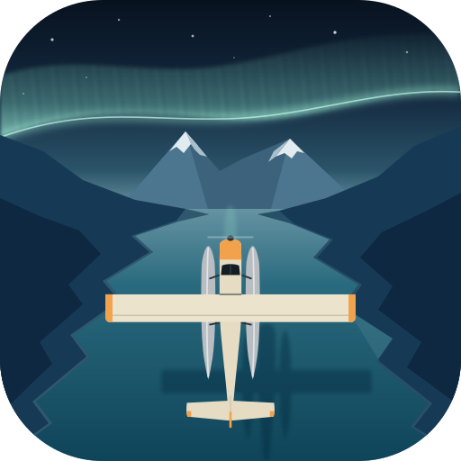
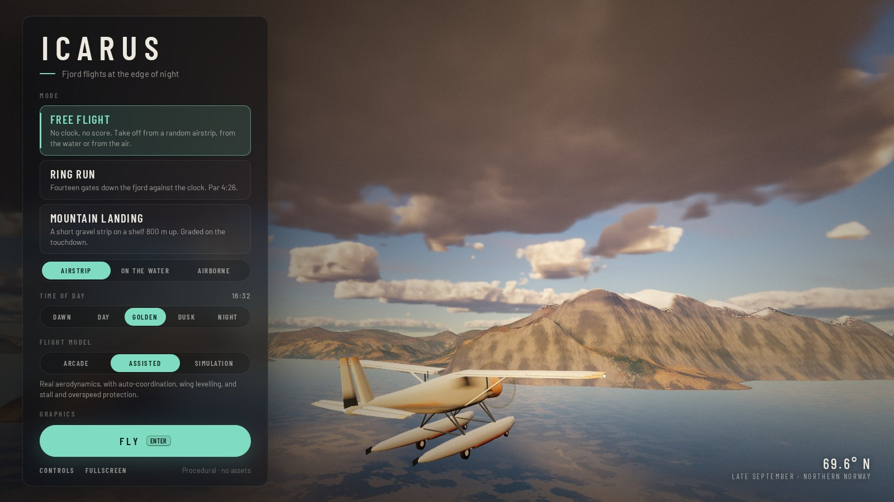
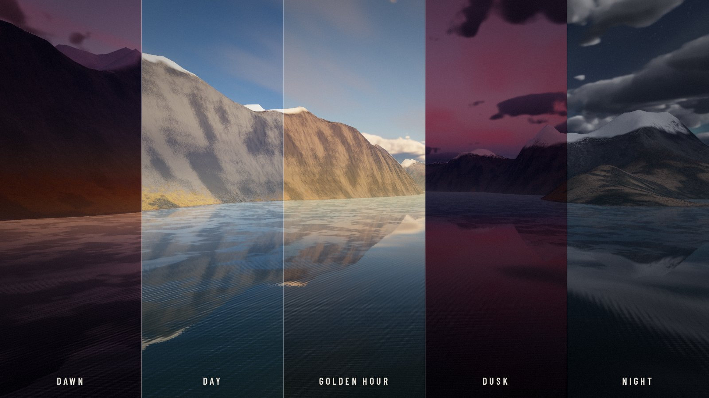
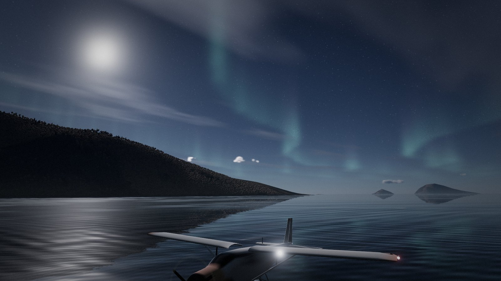
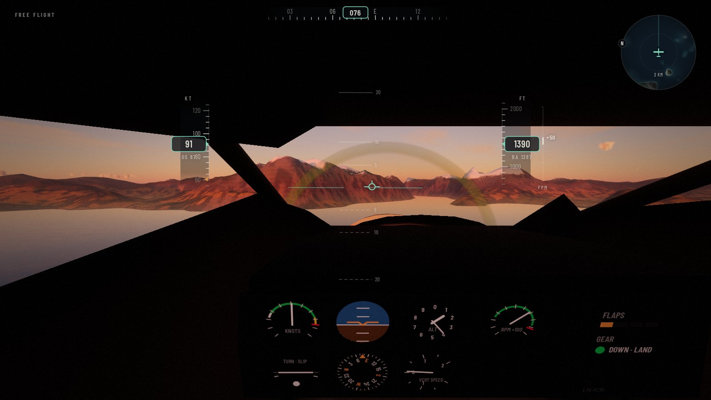
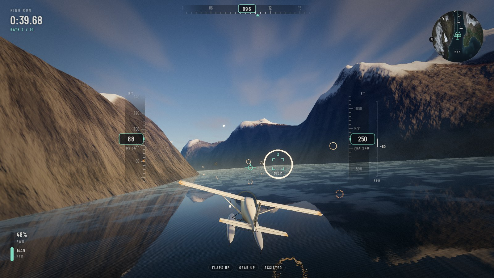
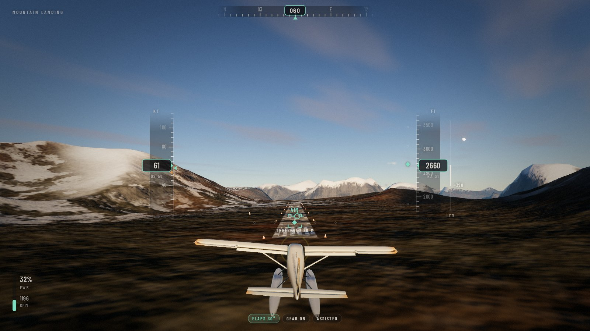
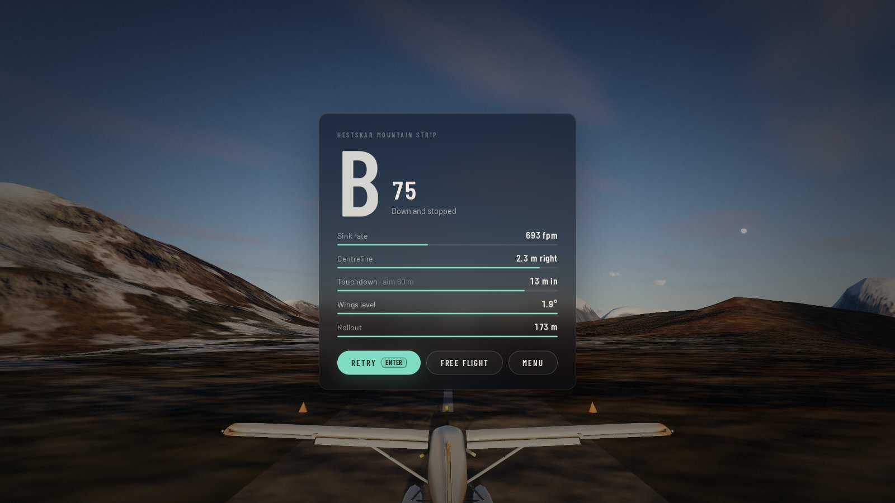

<p align="center"></p>

<h1 align="center">Icarus</h1>

<p align="center"><b>A calm, procedural flight simulator for the browser.</b><br>
A small amphibious bush plane over a far-north fjord, at the edge of night.</p>

<p align="center"><a href="https://nayed.github.io/icarus/"><b>Play it in your browser</b></a> (WebGL2 and a keyboard)
&nbsp;·&nbsp; <a href="https://github.com/nayed/icarus/actions/workflows/ci.yml"></a></p>

Icarus is a flight you take for the view, not for a score. You fly a bush plane through a fjord at
69.6° N in late September, when the days end in a long twilight and the aurora comes out at night.

Everything you see and hear is generated in code: the terrain, sky, sea, clouds and forests, the aircraft
and its instrument panel, even the engine sound. There are no models, textures or audio files. Built with
[Three.js](https://threejs.org) and TypeScript.



## The world

- **Fjords and mountains**: a main fjord with two arms, northern and southern fjord systems reaching
  35 km inland, a sound that breaks the coast into islands, lakes in the valleys and an archipelago
  offshore, among mountains shaped from noise, with snow above a treeline and forests in the valleys.
  The same terrain function runs on the CPU and the GPU, so the ground you land on is exactly the ground
  that is drawn.
- **Terrain to the horizon**, with a level-of-detail mesh that keeps the frame rate up.
- **A sea** with animated waves, reflections and colour that follows the water's depth.
- **A sky that follows the clock** at 69.6° N: sun and moon, stars and the Milky Way, volumetric clouds,
  fog, a long twilight, and the aurora at night.
- **Five airstrips**: Vika on the coast, Hestskar on a mountain shelf 800 m up, Hjelle on a shelf between
  the northern fjords, Botn at the head of the main fjord (one way: in from the fjord, out over it) and
  Vatne among the southern lakes.





## Flying

- **An amphibian**: the wheels in the floats come down for the strips and go up for the water.
- **A flight model** with lift and drag on each surface, stalls, ground effect, propeller torque, wind
  with gusts and crosswind, and wheels and floats that meet the actual ground and waves.
- **Three flight models**: *Arcade* is forgiving, *Assisted* adds coordination, wing levelling, and stall
  and overspeed protection to real aerodynamics, and *Simulation* leaves it all to you.
- **Chase, cockpit and cinematic cameras**, and a HUD with airspeed (knots), altitude (feet), heading,
  vertical speed (feet per minute) and throttle, with stall and overspeed warnings.
- **Maps**, drawn from the same terrain function on the GPU: a moving map in the corner of the HUD that
  turns with the aircraft (M hides it), and on the pause screen a chart of the fjord with the airstrips,
  the ring-run gates and the track you have flown, which you can zoom and drag.



## Modes

- **Free flight**: take off from a random airstrip (lined up into the wind), from the water, or start
  in the air.
- **Ring run**: fourteen gates down the fjord against the clock.
- **Mountain landing**: a final approach to the mountain strip, graded on sink rate, centreline,
  touchdown point, wings level and rollout.

<p>
  
  
</p>



## Controls

| Action | Keys |
|---|---|
| Pitch | W / S or ↑ / ↓ |
| Roll | A / D or ← / → |
| Rudder | Q / E |
| Throttle | R / F |
| Brakes | Space |
| Flaps down / up | X / Z |
| Gear | G |
| Trim | Y / T |
| Camera | C to cycle, or 1 chase, 2 cockpit, 3 cinematic; drag the mouse to look around |
| Landing light | L |
| Map / HUD / fullscreen | M / H / K |
| Pause | Esc or P (in fullscreen, Esc leaves fullscreen and pauses the flight; P resumes) |
| Controls list | I (pauses on it; I again to fly on) |
| Restart | Backspace |

Keys are read by their position, so the same physical keys work on any keyboard layout (the table uses
QWERTY names). Where the browser can tell, the controls sheet in the menu shows your own layout's labels.

## Run it

```bash
npm install
npm run dev
```

Then open http://localhost:5173. You need a browser with WebGL2 and a keyboard. Graphics presets (low,
medium, high) are in the menu, and the resolution scales automatically to hold 60 fps. Icarus is
developed and tested in Chromium.

`npm run build` produces a static site in `dist/` that can be hosted anywhere.

## Development

`npm test` runs the unit tests. The browser checks (CPU/GPU terrain parity, keyboard flight tests, game
modes, the menu flow, fallbacks, performance) run in headless Chromium through Playwright. See
[NOTES.md](NOTES.md) for those commands and the technical notes: how the terrain stays identical on CPU
and GPU, what has been verified, and known limitations. `node scripts/readme-shots.mjs` regenerates the
screenshots in this README.

Every push to `main` runs [GitHub Actions](.github/workflows/ci.yml): typecheck, unit tests, build, and
a smoke test that boots the built game in headless Chromium with software WebGL and fails on any shader
or console error. When all of that passes, the site is deployed to GitHub Pages.

## License

[MIT](LICENSE)
